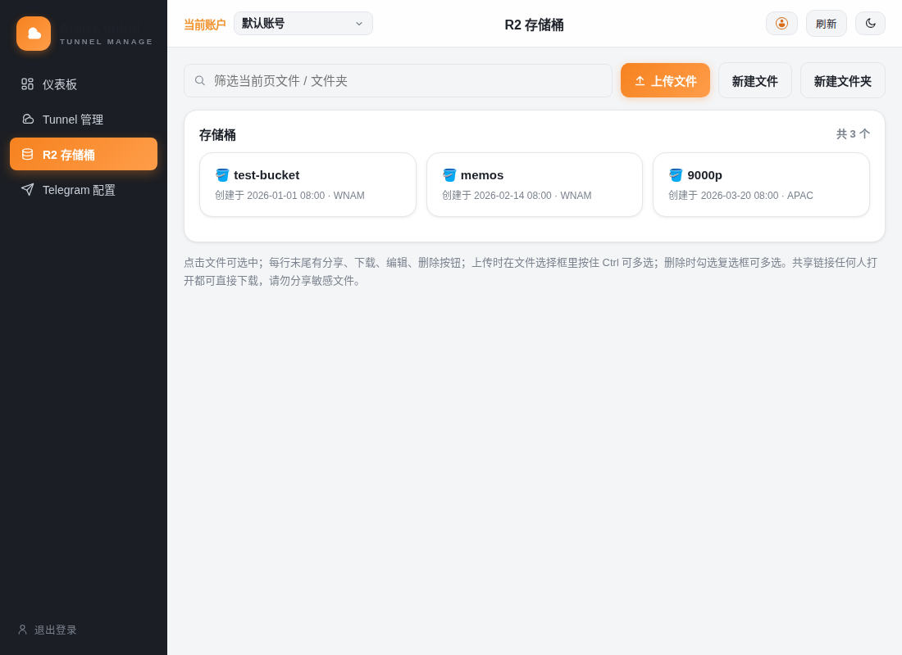
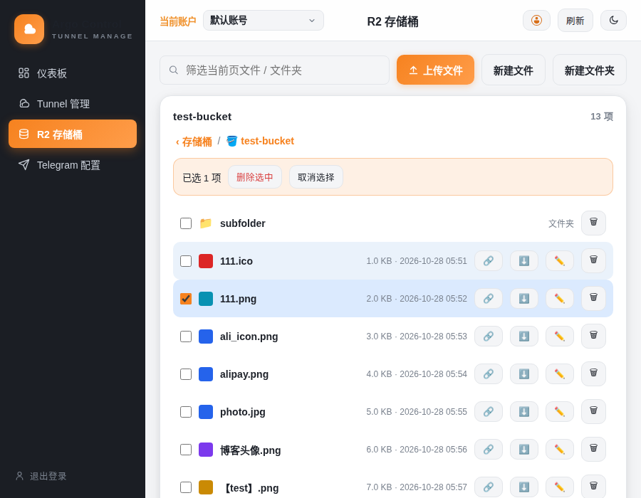
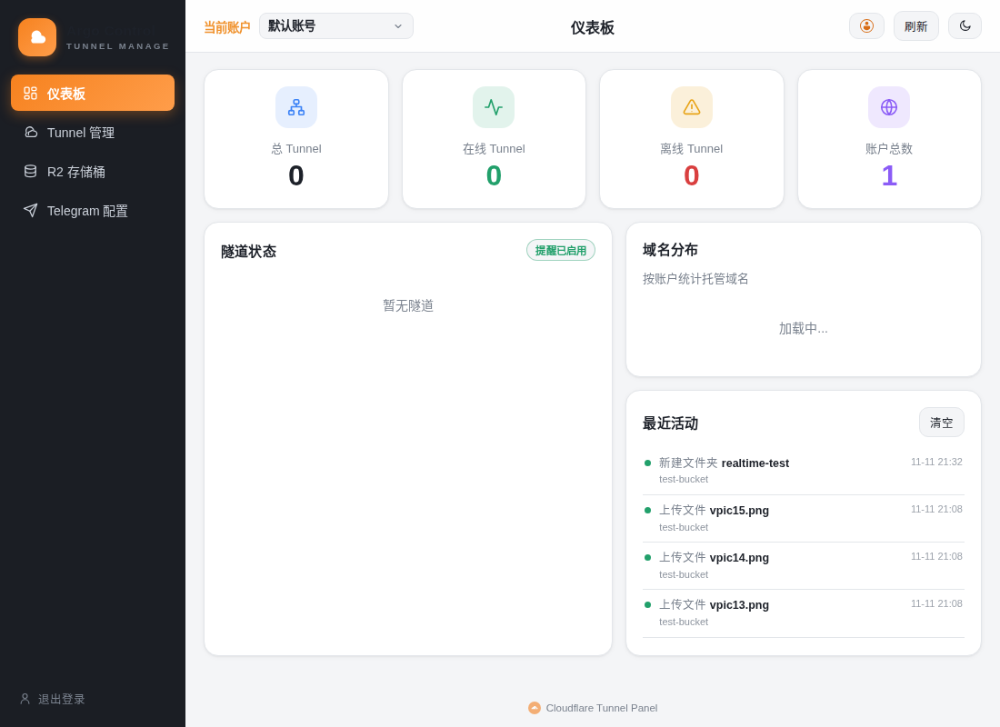
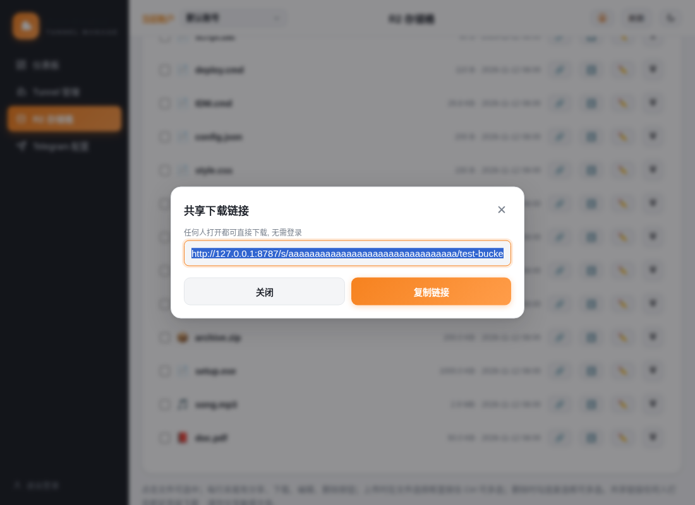
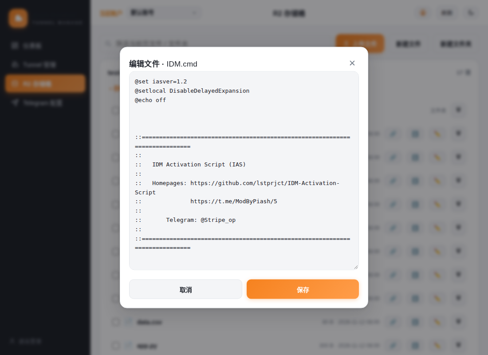

<div align="center">

# ⛅ Cloudflare Tunnel and R2 Pannel

**Multi-account Cloudflare Tunnel and R2 Web Panel**

*Single-file Worker · Zero build · Zero dependencies*

[](https://workers.cloudflare.com)
[](#)
[](#-storage-d1-recommended-or-kv)
[](#-telegram-notifications)
[](#)

English | **[简体中文](./README.md)**

</div>

> 💡 **Fork note**: This project is a fork of the original **Lao Wang**'s [Cloudflare Tunnel Panel](https://github.com/eooce/cloudflare-tunnel-panel), with a complete **R2 bucket management** feature added on top of the original Tunnel management (see [🪣 R2 Bucket Management](#-r2-bucket-management-new)).

---

## 🖼️ Screenshots

<div align="center">
  
  
  
</div>

<div align="center">
  
  
  
</div>

## ✨ Features

| | |
| --- | --- |
| 🔐 **Password Login** | Signed session cookie valid for 7 days, brute-force delay on the login endpoint, show/hide password toggle |
| 👥 **Multi-Account** | Switch Cloudflare accounts from the top bar dropdown; accounts are verified before being saved (tokens stored in D1/KV only); tunnels, routes and alert settings are isolated per account |
| 🖥️ **Tunnel Management** | Status badges (online/degraded/offline + uptime), search filter, launch token viewer, edit (pick a specific route when there are many), delete |
| 🪣 **R2 Buckets** | List all buckets of the current account; browse files/folders inside a bucket, upload (hold Ctrl in the file picker to select multiple), download, edit text files online (UTF-8/GBK), create files/folders, checkbox multi-delete; image thumbnails; one-click copy of a login-free public share link; R2 operations are recorded in the dashboard activity log |
| ➕ **Create Tunnel** | Pick zone + subdomain + optional path + local service, tunnel and DNS CNAME are created automatically |
| 🌐 **Route Management** | Up to 60 "hostname + path → service" ingress rules per tunnel, DNS handled automatically, conflicts are rejected |
| 📣 **Telegram Alerts** | Push only on status **change**, per-tunnel toggle (**off by default**), multiple recipients, pause/resume, test send |
| 🍩 **Dashboard** | Total/online/offline/accounts stat cards + domain distribution donut + recent activity (including R2 operations, refreshed in real time) |
| 🌗 **Themes** | Follows system + manual light/dark toggle, choice remembered locally |
| 📱 **PWA + Responsive** | Installable to home screen, adaptive layout for phone/tablet/desktop |

> The whole project is **a single file**: `_worker.js` (Worker code + embedded web UI).

## 🪣 R2 Bucket Management (New)

A complete R2 bucket management feature added on top of the original Tunnel management — no need to go to the Cloudflare dashboard to work with files.

<div align="center">
  
  
</div>

### Buckets and File Browsing

- The sidebar **R2 Buckets** lists all buckets of the current account, and follows the account switcher for multi-account setups.
- Click a bucket to browse its files and folders, with breadcrumb navigation; **‹ Buckets** in the top-left takes you back to the bucket list at any time.
- Folders expand by level; Chinese and special-character filenames display correctly. Large buckets paginate automatically (1000 keys per page, with a "Load more" button) — no more showing only the first 20 items.

<div align="center">
  
  
</div>

### Upload, Download and Sharing

- **Upload**: click "Upload", hold Ctrl in the file picker to select multiple files — they upload in one go (multipart upload).
- **Download**: click ⬇️ at the end of a row to download a single file.
- **Share link**: click 🔗 at the end of a row to generate a login-free public download link (`GET /s/<account-id>/<bucket>/<file>`). Anyone with the link can download directly, with Range resume support. The link itself is the credential — do not share sensitive files.

### Edit Text Files Online

- Click ✏️ at the end of a row to edit a text file online (creating a new file works the same way). Files up to 2MB, in **UTF-8 or GBK** encoding (Chinese Windows batch files such as .bat/.cmd are often GBK and open correctly).
- Editable formats: txt, md, json, js, css, html, xml, csv, log, yaml, yml, ini, sh, py, bat, cmd, ps1, tsx, ts.
- Clicking ✏️ on an image, video, executable, archive or other non-text file shows "This file cannot be edited!" instead of opening the editor by mistake.

### Create, Delete and Multi-Select

- **New folder**: click "New Folder". R2 has no real folders — this writes a zero-byte placeholder object ending in `/`.
- **Delete**: 🗑️ at the end of a row deletes a single file or folder (deleting a folder removes everything under it). Tick the checkboxes to delete multiple files at once; one operation is logged as a single activity entry.
- Clicking a file row only toggles its selection — it never triggers an accidental download.

### Image Thumbnails

- Image files (png/jpg/jpeg/gif/webp/svg/bmp/ico/avif) show a 20×20 preview thumbnail at the start of the row, so you can confirm the file at a glance. Non-image files keep their icons.

<div align="center">
  
</div>

### Activity Log

- R2 uploads, saves, folder creation, file and folder deletions are all recorded in the dashboard **Recent Activity**. Switching back to the dashboard refreshes it in real time — no manual refresh needed.
- Records are stored permanently (one D1 row per entry, no cap). The dashboard shows the newest 100 with internal scrolling; click **Clear** in the card header to delete all activity records of the current account (with confirmation).

## 🚀 Quick Start

### Option 1: Cloudflare Dashboard (easiest)

1. Sign in to the [Cloudflare Dashboard](https://dash.cloudflare.com) → **Workers & Pages** → **Create**, create a Worker and paste the entire `_worker.js` into it, then save.
2. **[Required] Bind storage**: Settings → Bindings → add a **D1 Database** (variable name `TUNNEL_DB`, schema [below](#-storage-d1-recommended-or-kv)) or a **KV Namespace** (variable name `TUNNEL_STATE`).
3. **[Required] Set environment variables**: Settings → Variables and Secrets, add `CF_API_TOKEN`, `CF_ACCOUNT_ID`, `PASSWORD` (see [Environment Variables](#-environment-variables)).
4. Open `https://<your-worker-domain>/` and sign in with your password.

### Option 2: wrangler CLI

```bash
wrangler d1 create tunnel-state   # note the database_id
wrangler d1 execute tunnel-state --remote \
  --command "CREATE TABLE IF NOT EXISTS state (k TEXT PRIMARY KEY, v TEXT NOT NULL)"
```

`wrangler.toml`:

```toml
name = "cf-tunnel-manage"
main = "_worker.js"
compatibility_date = "2024-09-23"

[[d1_databases]]
binding = "TUNNEL_DB"
database_name = "tunnel-state"
database_id = "<id from the previous step>"

[triggers]
crons = ["*/5 * * * *"]   # optional: check every 5 minutes and alert
```

```bash
wrangler secret put CF_API_TOKEN
wrangler secret put CF_ACCOUNT_ID
wrangler secret put PASSWORD
wrangler deploy
```

### Option 3: Fill values in code

Prefer not to use Secrets? Put the values directly into the **CONFIG section** at the top of `_worker.js` (`CONFIG_DEFAULTS`). Variables left empty still fall back to the Dashboard configuration.

## ⚙️ Environment Variables

| Variable | Required | Description |
| --- | --- | --- |
| `CF_API_TOKEN` | ✅ | API token, permissions see [API Token Permissions](#-api-token-permissions) |
| `CF_ACCOUNT_ID` | ✅ | Cloudflare account ID (shown on the right side of the Workers page) |
| `PASSWORD` | ✅ | Panel login password, at least 6 characters |
| `SESSION_SECRET` | Recommended | Session signing secret, a random string. Derived from the password when unset (changing the password then logs everyone out) |
| `TUNNEL_DB` | ✅* | **D1 database binding** (recommended). Takes precedence over `TUNNEL_STATE` when both are bound |
| `TUNNEL_STATE` | ✅* | **KV namespace binding**. The storage fallback when D1 is not bound — bind at least one of the two (*all features except persistence for alerts/accounts work without storage) |
| `DEFAULT_SERVICE` | Optional | Default local service address when creating/editing tunnels, e.g. `http://localhost:8080` |
| `TG_BOT_TOKEN` | Optional | Telegram bot token (env fallback; can also be saved in the panel) |
| `TG_CHAT_ID` | Optional | Default recipient chat_id (env fallback) |

## 🔑 API Token Permissions

When creating the API token (My Profile → API Tokens → Create Token → Custom token), select the two groups below. Note the difference between **account-level (the whole account)** and **zone-level (All zones)** permissions — similar names, completely different scopes:

**Account-level (Account Resources = the account):**

| Group | Permission | Level |
| --- | --- | --- |
| DNS & Zones | Account DNS Settings | Read + Edit |
| DNS & Zones | DNS View | Read + Edit |
| Cloudflare Tunnel (or Argo Tunnel) | Cloudflare Tunnel | Read + Edit |
| Workers R2 Storage | Workers R2 Storage | Read + Edit |

**Zone-level (Zone Resources = All zones):**

| Group | Permission | Level |
| --- | --- | --- |
| DNS & Zones | DNS | Read + Edit |
| DNS & Zones | Zone | Read + Edit |
| DNS & Zones | Zone DNS Settings | Read + Edit |
| DNS & Zones | Zone Settings | Read + Edit |

> 💡 The minimal working set is: account-level `Cloudflare Tunnel → Edit` + zone-level `DNS → Read/Edit` and `Zone → Read`; the extra checks are harmless redundancy. A common mistake is configuring only account-level Account DNS Settings / DNS View (they manage account-wide DNS settings, **not** DNS records inside a zone), which causes "domain already has DNS records" errors or failed DNS cleanup after deleting a tunnel — the **zone-level `DNS → Edit`** permission is required. To use **R2 bucket management**, the token also needs account-level `Workers R2 Storage → Read + Edit`, otherwise opening the R2 page reports "API token lacks R2 permission".

## 💾 Storage: D1 (Recommended) or KV

KV has daily write limits and eventual-consistency delays (a read right after a write may return a stale value). This panel reads and writes frequently, so D1 is recommended:

1. Dashboard → Storage & Databases → D1 → Create a database (any name, e.g. **`tunnel-state`**);
2. Open its console and run:

   ```sql
   CREATE TABLE IF NOT EXISTS state (k TEXT PRIMARY KEY, v TEXT NOT NULL);
   ```

3. Worker → Settings → Bindings → D1 Database, variable name **`TUNNEL_DB`**;
4. Redeploy. Without D1 the panel falls back to KV (`TUNNEL_STATE`) automatically; when both are bound D1 wins.

> 📦 D1 and KV share the same key layout (`meta:settings`, `tunnel:state:<account>:<tunnel>`, `chat:*`). After moving from KV to D1, simply re-save the Telegram configuration and re-enable tunnel alerts in the panel.

## 👥 Multi-Account

- The account configured via `CF_API_TOKEN` + `CF_ACCOUNT_ID` always exists as the built-in "Default account" and cannot be deleted.
- Switch accounts from the top bar dropdown; the tunnel list, domains, routes and alert switches all follow the selection. The choice is remembered in D1/KV.
- Click **Account Management** in the top bar to add (name + account ID + API token, **verified before saving**, token never echoed back), edit or delete accounts.
- Alert state (up/down records, 20-second debounce window) is isolated per account; the Cron check iterates over **all** accounts.
- Without storage the panel falls back to the single environment-variable account; everything else keeps working.

## 📣 Telegram Notifications

1. Find [@BotFather](https://t.me/BotFather) in Telegram, create a bot with `/newbot` and get the **Bot Token**.
2. **Whoever should receive alerts must message the bot first (or send `/start`)** — a bot cannot start a private chat with a user who never interacted with it.
3. Get the recipient's chat_id:
   - **Private chat**: message [@userinfobot](https://t.me/userinfobot), it replies with your **positive** numeric ID;
   - **Group**: add the bot to the group; group IDs are negative (supergroups usually start with `-100`);
   - **Public channel/group**: a `@username` works too — the panel resolves it to the real chat_id.
4. Open the panel → **Telegram**: fill in the chat_id (the **recipient**, not the bot's ID) and the Bot Token, click "**Test send**" to confirm delivery, then "**Save config**".
5. Go to **Tunnel Management** and flip the monitored tunnels from "🔕 Alerts off" to "🔔 Alerts on".

> ⚠️ Common mistake: the chat_id is "**who receives** the message" (your user ID / group ID), the Bot Token belongs to the bot. Using the bot's own ID triggers "a bot cannot message itself".

### How Alerts Work

- **Off by default**: each tunnel must be enabled manually; the state is stored in D1/KV.
- Sends once per status **change** (one message when up, one when down); no repeats for the same status. The first recorded state is silent, so deploying won't spam you.
- Check timing: every time the panel is opened/refreshed, with a 20-second minimum gap between checks (so network flapping isn't reported as multiple restarts).
- **Unattended checks**: add a Cron trigger (e.g. `*/5 * * * *`) to the Worker; the `scheduled` handler iterates over all accounts and runs the same checks.
- **Pause**: pausing from the panel (timed or indefinite) keeps recording status but stops sending messages.

## 📡 API Overview

All endpoints require login (cookie session) except `/api/login`. All are `POST` + JSON:

| Path | Description |
| --- | --- |
| `/api/login` `/api/logout` | Sign in / sign out |
| `/api/init` | Zone list, default service address, domain distribution |
| `/api/list` | Tunnel list + status + uptime + alert state (also triggers a check) |
| `/api/create` `/api/update` `/api/delete` | Create / update / delete tunnels |
| `/api/token` | Get the tunnel launch token (for cloudflared) |
| `/api/uptime` | Connector uptime (same source as the official "Uptime") |
| `/api/detail` `/api/route` | View / add/delete tunnel ingress routes |
| `/api/alert` | Per-tunnel alert toggle / skip one pending change |
| `/api/tg` | Telegram config: save, test, add/remove recipients, pause/resume |
| `/api/acc` | Accounts: list / add (verified first) / edit / delete / switch |
| `/api/r2/buckets` `/api/r2/objects` | List buckets / list folders and files in a directory (paginated) |
| `/api/r2/upload` `/api/r2/put` `/api/r2/get` | Multi-file upload / create & save text file / fetch text file content for editing |
| `/api/r2/mkdir` `/api/r2/delete` | Create folder / delete file or folder (multi-select supported) |
| `GET /s/<account-id>/<bucket>/<file>` | Login-free public share download link (Range resume supported) |

## ❓ FAQ

- **"KV namespace TUNNEL_STATE not bound"**: bind D1 (`TUNNEL_DB`) or KV (`TUNNEL_STATE`) — see [Storage](#-storage-d1-recommended-or-kv).
- **"chat_id not found"**: the private-chat recipient never sent `/start` to the bot; or the bot's ID / a positive number was used as a group ID. Private chats use your positive user ID, groups use negative IDs.
- **"Invalid bot token"**: check that the Bot Token was copied completely and the bot wasn't revoked in BotFather.
- **"Tunnel still has active connections, stop cloudflared first"**: stop the `cloudflared` process on the host before deleting (Cloudflare platform limitation).
- **"This domain already has other DNS records"**: delete the conflicting record on the Zone's DNS page first, or pick another subdomain.
- **"API token lacks R2 permission"**: add account-level `Workers R2 Storage → Read + Edit` to the API token (see [API Token Permissions](#-api-token-permissions)); for multi-account setups every account's token needs it.
- **"DNS cleanup failed" (after deleting a tunnel/route)**: check that the API token has the **zone-level Zone → DNS → Edit** permission (see [API Token Permissions](#-api-token-permissions)); the account-level Account DNS Settings does not replace it. The toast shows the exact reason.
- **Everyone gets logged out after changing the password**: without `SESSION_SECRET` the session key is derived from the password; setting a separate `SESSION_SECRET` avoids this.
- **Migrating from an old "alerts on by default" version**: the new version defaults to off and runs a one-time migration — old data is cleared to off the first time the panel is opened.

## 🔒 Security

- All Cloudflare API calls happen server-side in the Worker; tokens are never sent to the browser.
- R2 public share links (`/s/...`) need no login — the link itself is the credential, so anyone with it can download directly. Do not share sensitive files.
- The tunnel launch token (which can impersonate a tunnel) is fetched separately and only after login.
- The login password comparison uses a constant-time algorithm to prevent timing side channels; repeated failures trigger a delay penalty.
- Setting `SESSION_SECRET` is recommended, and adding Cloudflare Access in front of the Worker domain provides an optional second layer.

---

<div align="center">

**Argo Control** · Cloudflare Tunnel and R2 Manager

💝 [大爷博客](https://blog.118558.xyz)

</div>
